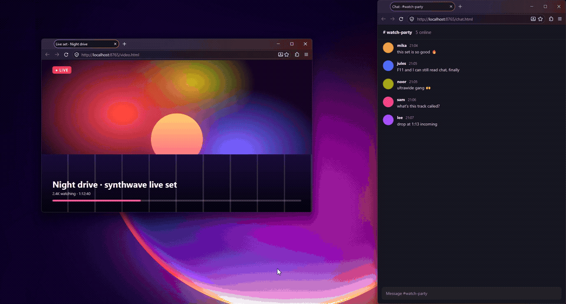
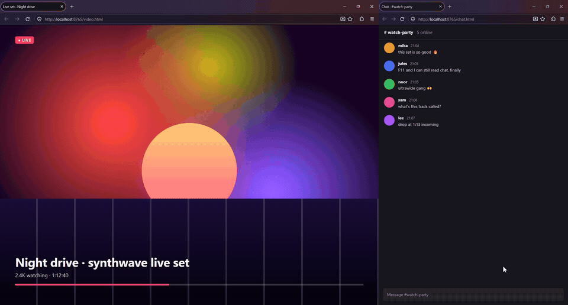
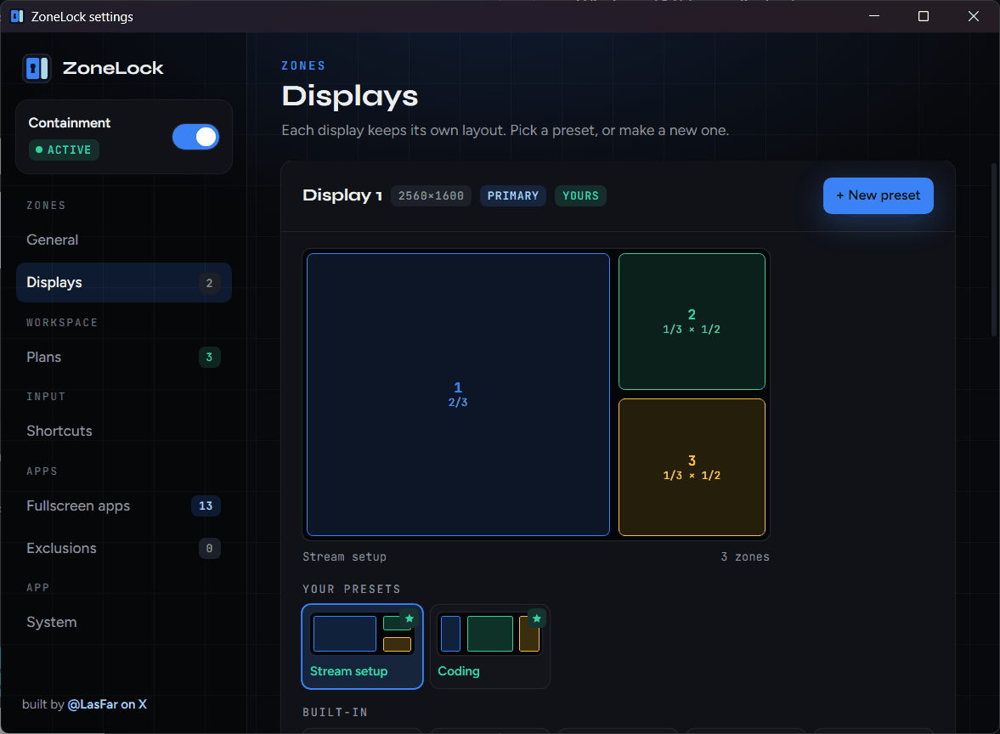
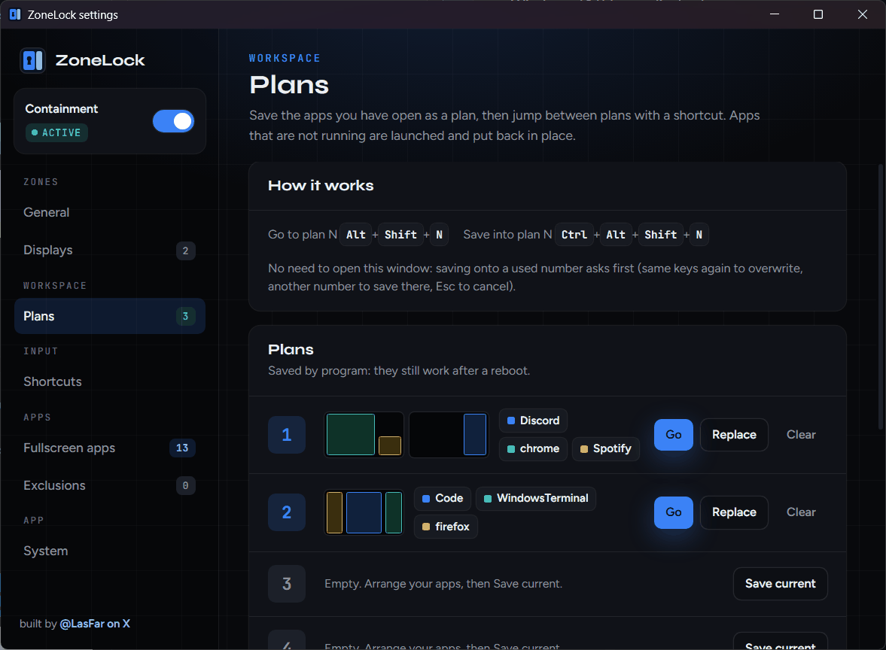
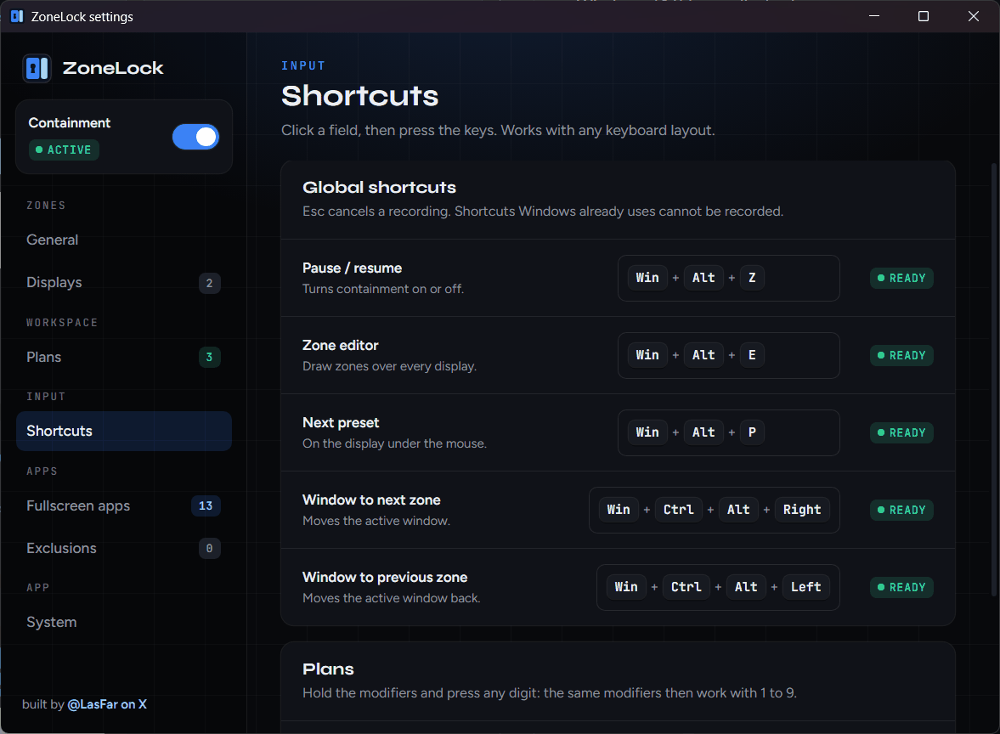
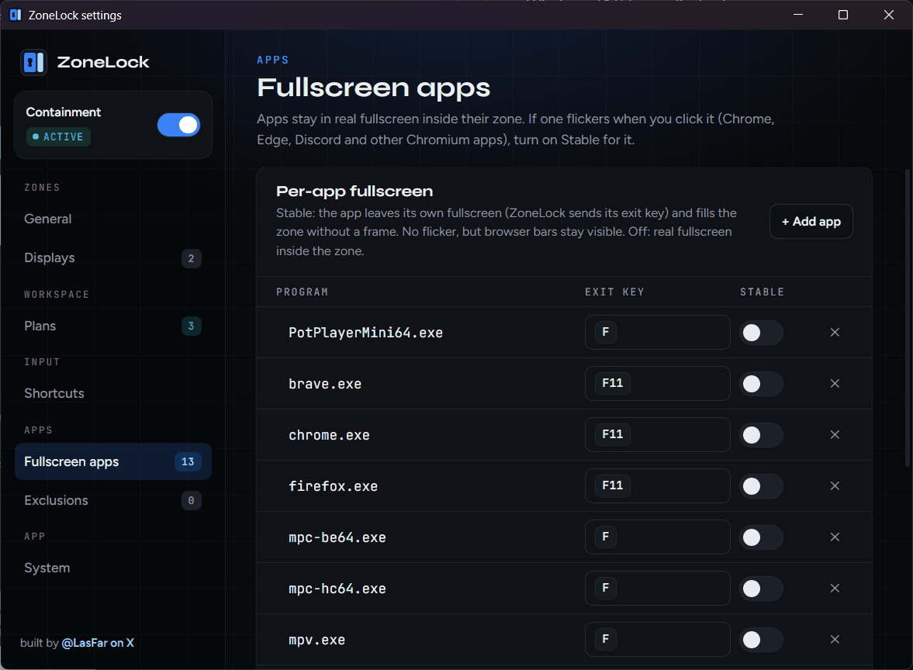

<div align="center">


# ZoneLock

**Snap windows into zones. Even F11 fullscreen stays in its zone.**

Split any screen into zones and snap your apps into them.
Fullscreen video stays in its zone. Your chat stays visible.

[](https://github.com/OhLasFar/ZoneLock/releases/latest)
[](https://github.com/OhLasFar/ZoneLock/releases)
[](https://github.com/OhLasFar/ZoneLock/actions/workflows/ci.yml)
[](LICENSE)
[](#install)
[](#build-from-source)

### [Download for Windows](https://github.com/OhLasFar/ZoneLock/releases/latest)



</div>

---

## Why ZoneLock?

On a wide screen you want a video on the left and your chat on the right.
Then you hit **F11**, and the video takes the whole screen.
Window managers like PowerToys FancyZones let you snap windows into zones,
but a fullscreen window still covers the whole monitor
([PowerToys #279](https://github.com/microsoft/PowerToys/issues/279), open
since 2019).

**ZoneLock fixes exactly that.** F11 gives you real fullscreen, inside the
zone. Everything else is built around it: snapping,
presets per display, saved workspaces, and windows that come back where you
left them.

It is a single ~1 MB program. No admin rights, no account, no telemetry, no
code injected into other apps.

## Plans: one key per setup

Watching something with friends, then back to work, then back again?
Save each arrangement of apps as a **plan** and switch with one shortcut.
The apps of the plan come back exactly where you left them, everything else
steps aside (minimized, not closed). Apps that are not running are launched
for you, even after a reboot.

<div align="center">

</div>

`Ctrl+Alt+Shift+1…9` saves the apps you have open as plan 1–9.
`Alt+Shift+1…9` goes to that plan. Nothing to set up first.

**On a laptop?** Link a plan to each set of screens in
**Settings → Plans → Plans that follow your screens**: a "docked" plan for laptop +
monitor, a "laptop only" plan for the road. Unplug the monitor and the open
windows of the laptop plan go to their place; plug it back and the docked
plan returns. Nothing is launched or minimized, and the focus stays where it
is. Each screen is recognised by its model and serial number (two identical
monitors stay apart), whatever the port or dock, and virtual
displays (Parsec, Remote Desktop) are ignored.

## Features

| | |
|---|---|
| **Zones per display** | Every monitor gets its own layout. Pick a built-in preset (halves, thirds, 2/3 + 1/3, grid, focus…) or draw your own and save it. |
| **F11 stays in its zone** | A window sitting in a zone goes **real fullscreen** (no bars, no tabs) inside that zone, and the rest of the screen keeps working. A window that is not in a zone (Parsec or Remote Desktop connecting, a game, a player you moved out) gets the whole screen as usual. |
| **Shift + drag to snap** | Hold Shift while moving a window: the zones light up, drop it on one. |
| **Drag out, get your size back** | Pull a snapped window out of its zone and it returns to the size it had before, right under your cursor. |
| **Zone shortcuts** | `Win+Ctrl+Alt+→ / ←` moves the active window to the next / previous zone. |
| **Plans 1–9** | Save the apps you have open and where they are, then switch with `Alt+Shift+1…9`. Apps that are not running are launched and put back in place, everything else is minimized. Survives reboots. |
| **Reopen where you left it** | Close an app, open it later: it comes back on the same display, at the same spot. |
| **Display changes handled** | Change resolution, scaling or the taskbar, unplug a monitor: windows go back into their zones. A missing display falls back to the main one. |
| **A plan per set of screens** | Docked and laptop-only plans: unplugging or plugging a monitor puts the open windows where that setup's plan wants them. |
| **Settings panel** | A clean panel from the tray icon. Every change applies instantly. Shortcuts are recorded by pressing them, on any keyboard layout. |
| **Updates in one click** | ZoneLock tells you when a new version is out and installs it for you (Settings → System). Can be turned off. |
| **Light** | ~1 MB, ~2 MB of RAM in the background. The settings window only runs while it is open. |

## Screenshots

<table>
<tr>
<td width="50%"><br><sub><b>Displays.</b> Your screens as in Windows, each with its own zones.</sub></td>
<td width="50%"><br><sub><b>Plans.</b> Workspaces you switch with one shortcut.</sub></td>
</tr>
<tr>
<td><br><sub><b>Shortcuts.</b> Click, press the keys, done.</sub></td>
<td><br><sub><b>Fullscreen apps.</b> Per-app fullscreen behaviour.</sub></td>
</tr>
</table>

## Install

Windows 10 or 11, 64-bit. Grab the latest version from the
**[Releases page](https://github.com/OhLasFar/ZoneLock/releases/latest)**:

| File | What it is |
|---|---|
| `zonelock-x.y.z-setup.exe` | **Installer** (recommended). Per-user, no admin. Adds a Start menu entry, can start with Windows, uninstalls from *Settings → Apps*. |
| `zonelock-x.y.z-win-x64.msi` | **MSI package**, the same per-user install without admin. Handy for scripted or IT installs: `msiexec /i zonelock-x.y.z-win-x64.msi /qn`. Uninstalls from *Settings → Apps*. |
| `zonelock-x.y.z-win-x64.zip` | **Portable.** Unzip anywhere and run `zonelock.exe`. |
| `SHA256SUMS.txt` | Checksums to verify your download. |

> [!NOTE]
> ZoneLock is not code-signed yet, so Windows SmartScreen may say
> *"Windows protected your PC"* the first time. Click **More info → Run
> anyway**. The full source is here and every release is built by
> [GitHub Actions](https://github.com/OhLasFar/ZoneLock/actions) from this
> repository.

## Quick start

1. **Run ZoneLock.** Its icon appears in the system tray (next to the clock).
2. **Left-click the icon** to open Settings → **Displays**, and pick a layout
   for each monitor (or click **+ Draw my own** and draw one).
3. **Use your apps.** Hold **Shift** while dragging a window to snap it into
   a zone. Press F11 in a video sitting in a zone: it stays in its zone.
   The maximize button is a normal maximize.

Right-click the tray icon for **Active** (pause / resume) and **Quit**.

## Shortcuts

All of them can be changed in **Settings → Shortcuts**. Forgot one? Press
`Win+Alt+H`: a card in the middle of the screen lists them all.

| Shortcut | Action |
|---|---|
| `Win+Alt+H` | Show every shortcut (Esc or the same keys to close) |
| `Shift` + drag a window | Show the zones and snap the window into one |
| `Win+Ctrl+Alt+→` | Move the active window to the next zone |
| `Win+Ctrl+Alt+←` | Move the active window to the previous zone |
| `Win+Ctrl+Alt+↑` | Fullscreen window: switch between its zone and the whole screen (no buttons needed, handy for Parsec or games) |
| `Win+Alt+P` | Next preset on the display under the mouse |
| `Win+Alt+E` | Zone editor: draw, move and resize zones on every display |
| `Win+Alt+Z` | Pause / resume ZoneLock |
| `Alt+Shift+1…9` | Go to plan 1–9 |
| `Ctrl+Alt+Shift+1…9` | Save the open apps as plan 1–9 (asks before overwriting) |
| `F11` / `Esc` | Leave fullscreen as usual |

In the zone editor: drag to draw a zone, or click a **+** (the big one fills
an empty spot, the small ones on a zone's sides split it in two). Drag an
edge to resize: zones sharing it follow (hold `Ctrl` to move one zone only).
`G` shows a grid to snap to, right-click deletes, `1`–`7` apply a built-in
preset, `Enter` saves (a new layout asks for its name), `Esc` cancels.
Zones too small for one of your apps show that app's icon crossed out.

## Good to know

<details>
<summary><b>Chrome / Edge / Discord flicker when I click them in fullscreen</b></summary>

Chromium-based apps briefly snap back to the full monitor size on every
click while fullscreen, and ZoneLock puts them back a few milliseconds later.
If that flash bothers you, open **Settings → Fullscreen apps** and turn on
**Stable** for that app: it then leaves its own fullscreen and fills the zone
without a frame. No flicker, but the browser bars stay visible. Firefox does
not need it.
</details>

<details>
<summary><b>Games</b></summary>

Windows that are born fullscreen (exclusive fullscreen games, splash
screens) are never touched. If a borderless game gets confined anyway, add it
to **Settings → Exclusions**.
</details>

<details>
<summary><b>A shortcut says "taken"</b></summary>

Another program (or Windows itself) already uses that combination. For
example `Win+Alt+arrows` belong to Windows 11 snapping. Click the field and
press a different combination.
</details>

<details>
<summary><b>Where are my settings?</b></summary>

`%APPDATA%\ZoneLock\`: `config.json` (zones, presets, plans, shortcuts),
`positions.json` (where each app was last left) and `setups.json` (the sets
of screens seen, for plans that follow your screens). Uninstalling keeps them, so
reinstalling brings everything back. Delete the folder for a clean start.
</details>

<details>
<summary><b>Why is there sometimes a one-frame flash?</b></summary>

ZoneLock never injects code into other programs. It watches window events
from the outside and corrects a window right after it changes, so on slow
machines you may see one frame before the fix. That is the price of staying
out of other apps' processes, and it is the safe choice.
</details>

## Privacy & safety

- **One connection, for updates only.** Once a day ZoneLock asks GitHub
  whether a newer release of ZoneLock exists (a plain request with no data
  about you). Turn it off in **Settings → System**. No analytics, no crash
  reports, nothing else goes online.
- **Verified updates.** An update is downloaded from this repository's
  releases only, checked against the release's SHA-256 checksums, then
  installed; ZoneLock restarts by itself.
- **No injection.** It only uses public Windows APIs (`SetWinEventHook`
  out-of-context, `SetWindowPos`). Nothing is loaded into other apps.
- **No admin.** Everything runs as your user; the installer is per-user.
- **Never steals focus.** Windows are moved without being activated. The only
  exception is switching to a plan, which brings that plan's top app forward.
- **Local files only**, under `%APPDATA%\ZoneLock`. A corrupt config is
  reported, never silently overwritten.

## How it works

ZoneLock listens to window events (show, move, resize, minimize) with
out-of-context WinEvent hooks on its own thread. A small state machine per
window decides what to do:

- a **maximized** window is left alone: maximize is always a real maximize;
- a window that goes **fullscreen** while sitting in a zone is held inside it while it stays in
  its own fullscreen mode (the app keeps hiding its bars); leaving fullscreen
  gives it back its frame and its place. A free-floating window going
  fullscreen gets the whole display;
- a window **born** covering a monitor (a game) is left alone forever.

The settings window is an HTML page compiled into the exe and shown with the
WebView2 runtime that ships with Windows (no network, strict content security
policy). If WebView2 is missing, a built-in native panel is used instead.

## Build from source

ZoneLock builds on Windows 10 or 11 (64-bit) with the standard Rust tools.
No admin rights are needed past installing the tools.

**1. Install the tools** (once)

- [Git](https://git-scm.com/download/win).
- The **Visual Studio Build Tools** with the *Desktop development with C++*
  workload (it brings the MSVC linker and the Windows SDK):
  `winget install Microsoft.VisualStudio.2022.BuildTools`, then pick that
  workload in the Visual Studio Installer.
- **Rust** through [rustup](https://rustup.rs/) (`winget install
  Rustlang.Rustup`), keeping the default `stable-x86_64-pc-windows-msvc`
  toolchain.

**2. Build**

```powershell
git clone https://github.com/OhLasFar/ZoneLock.git
cd ZoneLock
cargo build --release          # -> target\release\zonelock.exe (~1 MB)
.\target\release\zonelock.exe  # run it (the icon shows up in the tray)
```

`cargo build` (no `--release`) makes a faster-to-build debug exe in
`target\debug\`. The Settings window uses the WebView2 runtime that ships
with Windows 11 and current Windows 10.

**3. Test** (optional)

```powershell
cargo test                     # unit tests + real-window integration tests
```

Integration tests create real windows on your desktop: run them in a normal
desktop session and quit a running ZoneLock first.

**4. Package** (optional, what a release ships)

```powershell
powershell -ExecutionPolicy Bypass -File packaging\package.ps1
```

This writes to `dist\`: the portable zip and exe, `SHA256SUMS.txt`, the
`setup.exe` if [Inno Setup 6](https://jrsoftware.org/isinfo.php) is
installed, and the `.msi` if the WiX Toolset is installed
(`dotnet tool install --global wix --version 5.0.2`, needs the
[.NET SDK](https://dotnet.microsoft.com/download)).

If the build fails with *Access is denied*, ZoneLock is still running from
`target\release`: quit it from the tray icon and build again.

Project tour: the pure logic (zones, engine state machine, plans, settings
model) is unit-tested in `src/*.rs`; the Win32 layer is `watcher.rs`,
`place.rs`, `monitor.rs`; the settings page is `src/web/settings.html`
(plain HTML/CSS/JS, no build step); its design rules are in
[`docs/UI.md`](docs/UI.md).

## Contributing

Bug reports and ideas are welcome in
[Issues](https://github.com/OhLasFar/ZoneLock/issues). For a bug, the log at
`%APPDATA%\ZoneLock\zonelock.log` (Settings → System) helps a lot. Pull
requests: keep ZoneLock's rules (no DLL injection, never steal focus, no
network besides the update check) and run `cargo test` before sending.

## License

ZoneLock is free software under the
[GNU General Public License v3.0 or later](LICENSE).
The embedded fonts (Figtree, Syne, JetBrains Mono) are under the
[SIL Open Font License 1.1](src/web/fonts/OFL.txt).

<div align="center">

---

Made by [@LasFar](https://x.com/LasFar) · If ZoneLock saves your ultrawide, a star helps others find it.

[](https://star-history.com/#OhLasFar/ZoneLock&Date)

</div>
