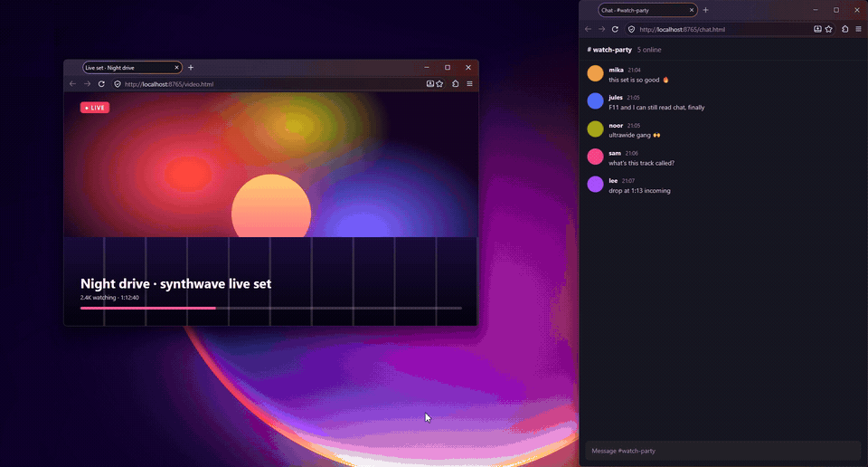

The first public release of **ZoneLock**: maximize and F11 fullscreen, kept inside your zones.

### Highlights

- 🔲 **Maximize stays in its zone**: the maximize button fills the zone, not the whole screen.
- 🎬 **Real F11 fullscreen inside a zone**: browsers and video players hide their bars and stay in their zone, the rest of the screen keeps working. Per-app **Stable** mode for Chromium apps that flicker.
- 🧱 **A layout per display**: built-in presets, your own presets (drawn in the zone editor), one click to switch.
- 🧲 **Shift + drag to snap**, and **drag out to get the window's size back**.
- ⌨️ **Zone shortcuts**: `Win+Ctrl+Alt+→ / ←` move the active window between zones.
- 🗂️ **Plans 1–9**: save your open apps and where they sit, switch with `Alt+Shift+1…9`; missing apps are launched and placed, even after a reboot. `Ctrl+Alt+Shift+1…9` saves (asks before overwriting).
- 📌 **Apps reopen where you left them**, on the same display (or the main one if that display is gone).
- 🖥️ **Resolution, scaling, taskbar and monitor changes**: windows go back into their zones.
- 🎛️ **Settings panel** from the tray icon: instant apply, shortcuts recorded by pressing them on any keyboard layout.

### Download

| File | |
|---|---|
| `zonelock-1.0.0-setup.exe` | Installer (recommended): per-user, no admin, optional start with Windows |
| `zonelock-1.0.0-win-x64.zip` | Portable: unzip and run `zonelock.exe` |
| `SHA256SUMS.txt` | Checksums |

Windows 10 / 11, 64-bit. ~1 MB, no network, no telemetry, no code injection.

> **SmartScreen:** the exe is not code-signed yet, so Windows may show *"Windows protected your PC"*. Click **More info → Run anyway**. This release was built from source by GitHub Actions.
